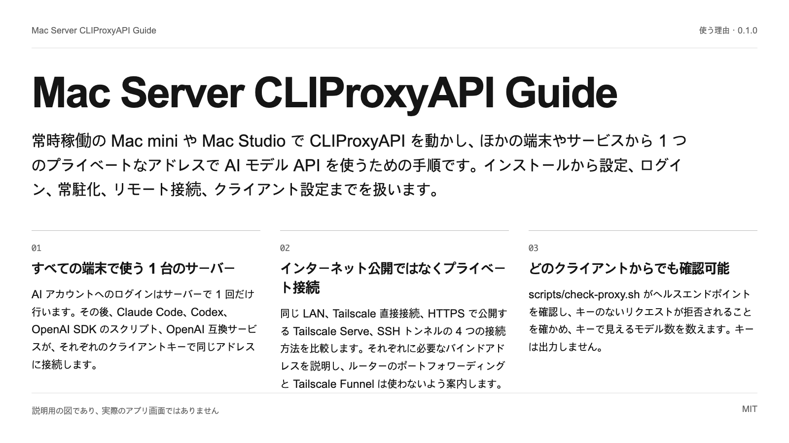
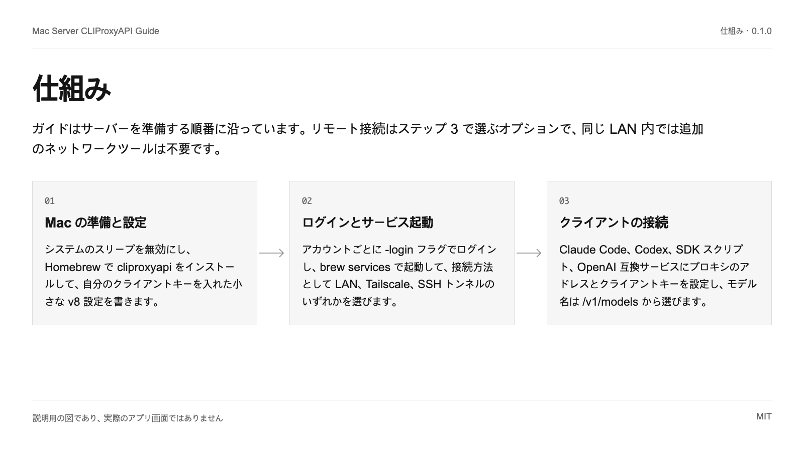
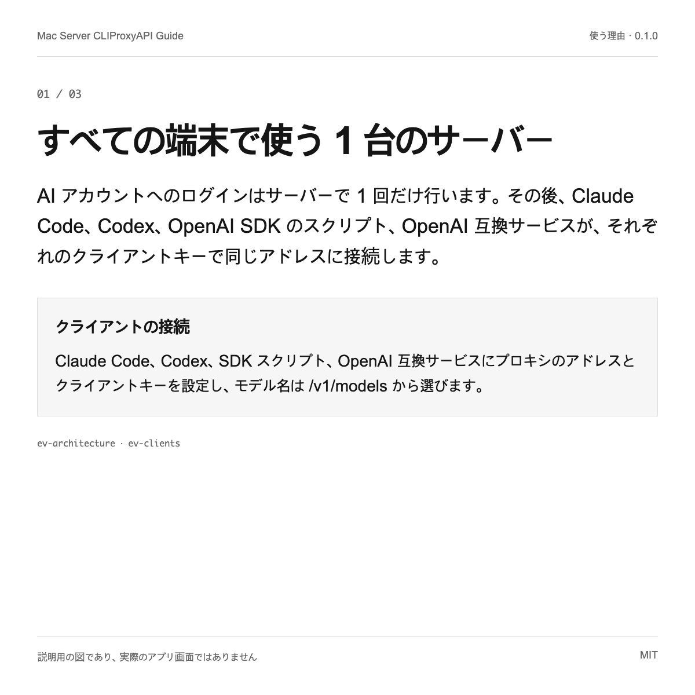
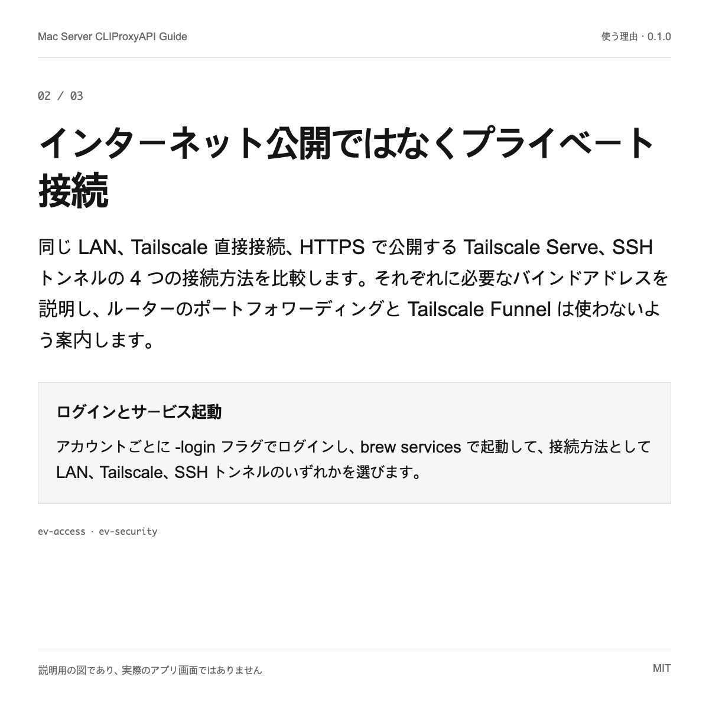
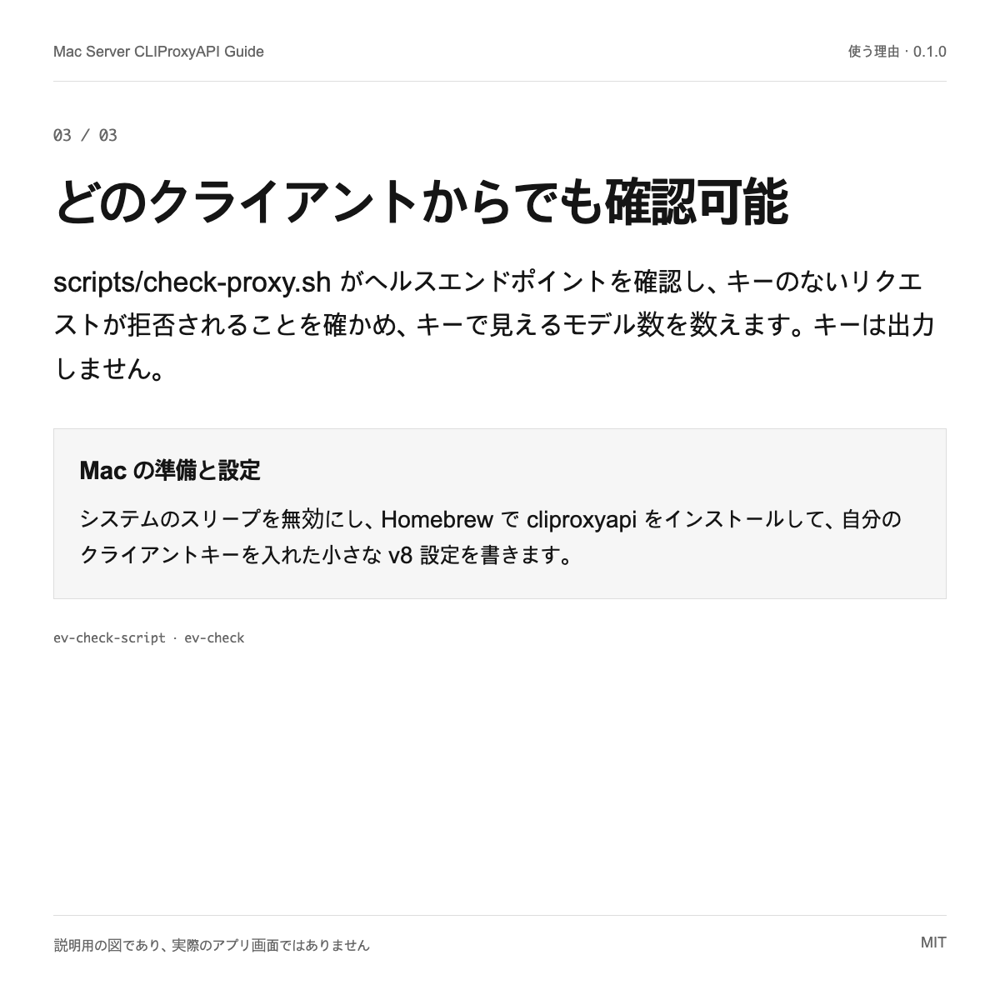

# Mac Server CLIProxyAPI Guide

常時稼働の Mac mini や Mac Studio で CLIProxyAPI を動かし、ほかの端末やサービスから 1 つのプライベートなアドレスで AI モデル API を使うための手順です。インストールから設定、ログイン、常駐化、リモート接続、クライアント設定までを扱います。

[English](README.md) | [한국어](README.ko.md) | **日本語** | [简体中文](README.zh.md)



0.1.0 · MIT

## 使う理由

| | |
| --- | --- |
| すべての端末で使う 1 台のサーバー | AI アカウントへのログインはサーバーで 1 回だけ行います。その後、Claude Code、Codex、OpenAI SDK のスクリプト、OpenAI 互換サービスが、それぞれのクライアントキーで同じアドレスに接続します。 |
| インターネット公開ではなくプライベート接続 | 同じ LAN、Tailscale 直接接続、HTTPS で公開する Tailscale Serve、SSH トンネルの 4 つの接続方法を比較します。それぞれに必要なバインドアドレスを説明し、ルーターのポートフォワーディングと Tailscale Funnel は使わないよう案内します。 |
| どのクライアントからでも確認可能 | scripts/check-proxy.sh がヘルスエンドポイントを確認し、キーのないリクエストが拒否されることを確かめ、キーで見えるモデル数を数えます。キーは出力しません。 |

## クイックスタート

Homebrew を入れた Apple Silicon の Mac mini または Mac Studio と、CLIProxyAPI が対応するアカウントが必要です。サービスを起動する前に、$(brew --prefix)/etc/cliproxyapi.conf のサンプルキーを自分で作ったクライアントキーに置き換えます（docs/guide.md 5 章）。最後のコマンドはこのリポジトリのクローンで実行します。

```text
brew install cliproxyapi
cliproxyapi -claude-login
brew services start cliproxyapi
PROXY_URL=http://127.0.0.1:8317 PROXY_KEY=<client-key> ./scripts/check-proxy.sh
```

チェックはヘルスエンドポイント、キーなしリクエストの拒否、モデル一覧について PASS を表示し、最後に ALL CHECKS PASSED を表示します。

## Claude Code・Codex に任せる

[AGENTS.md](AGENTS.md) は、このガイドをコーディングエージェント向けの手順にしたファイルです。Codex は直接読み、Claude Code は CLAUDE.md 経由で読みます。エージェントは最初に役割と接続方法を尋ね、人にしかできない手順（パスワード入力、ブラウザでのサインイン、システム設定）で止まり、キーを画面に表示しません。このリポジトリのクローンでエージェントを 1 つ開きます。

```sh
git clone https://github.com/grow1023/mac-server-cliproxyapi-guide
cd mac-server-cliproxyapi-guide
claude    # Claude Code (CLAUDE.md -> AGENTS.md)
codex     # Codex (AGENTS.md)
```

次にプロンプトを 1 つ貼り付けます。サーバー Mac では次を使います。

```text
AGENTS.md に従って、この Mac を CLIProxyAPI サーバーとして設定してください。接続方法は最初に私に聞いてください。HUMAN の手順ごとに止まり、私が終えるまで待ってください。クライアントキーは決して表示しないでください。scripts/check-proxy.sh が exit 0 になったときだけ完了です。
```

クライアントのコンピューターでは次を使います。

```text
AGENTS.md に従って、このコンピューターを私の CLIProxyAPI サーバーのクライアントとして接続してください。サーバーのアドレスは私に聞いてください。私が指定したツールだけを設定し、変更前に各ファイルをバックアップしてください。scripts/check-proxy.sh が exit 0 になったときだけ完了です。
```

コマンドを承認する前に内容を読んでください。権限確認を省略するモードでエージェントを起動しないでください。

## 仕組み

ガイドはサーバーを準備する順番に沿っています。リモート接続はステップ 3 で選ぶオプションで、同じ LAN 内では追加のネットワークツールは不要です。



### Mac の準備と設定

システムのスリープを無効にし、Homebrew で cliproxyapi をインストールして、自分のクライアントキーを入れた小さな v8 設定を書きます。

### ログインとサービス起動

アカウントごとに -login フラグでログインし、brew services で起動して、接続方法として LAN、Tailscale、SSH トンネルのいずれかを選びます。

### クライアントの接続

Claude Code、Codex、SDK スクリプト、OpenAI 互換サービスにプロキシのアドレスとクライアントキーを設定し、モデル名は /v1/models から選びます。

## 活用例

### 自宅の AI ゲートウェイ

リビングの Mac mini が、同じ LAN のノート PC とデスクトップに API を提供します。

### 外出先でも自分の端末だけ

Tailscale を使えば、インターネットにポートを開けずに外出先のノート PC からサーバーに接続できます。

### 自動化ツールの接続

n8n、Open WebUI、自作スクリプトが OpenAI 互換の Base URL と専用キーで接続します。







## 制約とプライバシー

- コマンドと設定キーは CLIProxyAPI v8.0.76 のソースと Homebrew formula で確認しました。このガイドのために全手順を実機サーバーで再実行してはいません。

- CLIProxyAPI は頻繁に変わります。ほかのバージョンではフラグ、キー名、Codex の設定形式が異なる場合があります。

- サブスクリプションアカウントをプロキシ経由で使う場合は、各提供元の規約に従う必要があります。ほかの人とアカウントを共有すると規約違反になる場合があります。

- サーバーは OAuth トークンを ~/.cli-proxy-api に保存します。このフォルダーやクライアントキーを持つ人は、あなたのアカウントの利用枠を使えます。

## 検証状況

- **実行確認済み**: tests/run.sh をローカルで実行しました。shellcheck、ローカルスタブに対する check-proxy.sh（正常、誤ったキー、キーなしで通過、モデルなし、サーバー停止）、設定例、文書リンク、英語・韓国語の一致、上流フラグ一覧、プライバシー検査がすべて合格しました。
- **コード確認済み**: ログインフラグ、キーヘッダー、API パス、デフォルトポート、Homebrew の設定パスは、上流コミット 7df5607 のソースと formula で確認しました。
- **文書に記載**: 未検証：実アカウントでの CLIProxyAPI 実行、リモート接続、各クライアント連携。

## 次のステップ

詳しい手順は docs/guide.md（英語）または docs/guide.ko.md（韓国語）を読み、接続した各クライアントで scripts/check-proxy.sh を実行してください。

<details>
<summary>根拠一覧</summary>

[JSON](docs/showcase/sources.json)

- `ev-scope`: `docs/guide.md`, L7–L7 (文書に記載)
- `ev-architecture`: `docs/guide.md`, L25–L46 (文書に記載)
- `ev-awake`: `docs/guide.md`, L58–L72 (文書に記載)
- `ev-install`: `docs/guide.md`, L74–L101 (コード確認済み)
- `ev-config`: `docs/guide.md`, L103–L142 (コード確認済み)
- `ev-login`: `docs/guide.md`, L144–L172 (コード確認済み)
- `ev-service`: `docs/guide.md`, L174–L192 (コード確認済み)
- `ev-check`: `docs/guide.md`, L194–L210 (文書に記載)
- `ev-access`: `docs/guide.md`, L212–L224 (文書に記載)
- `ev-clients`: `docs/guide.md`, L226–L288 (文書に記載)
- `ev-security`: `docs/guide.md`, L290–L297 (文書に記載)
- `ev-example-config`: `examples/config.server.yaml`, L1–L29 (コード確認済み)
- `ev-check-script`: `scripts/check-proxy.sh`, L1–L52 (コード確認済み)
- `ev-tests`: `tests/run.sh`, L1–L134 (実行確認済み)

- `one-server` → `ev-architecture`, `ev-clients`
- `private-access` → `ev-access`, `ev-security`
- `checkable` → `ev-check-script`, `ev-check`
- `flow-install` → `ev-awake`, `ev-install`, `ev-config`, `ev-example-config`
- `flow-run` → `ev-login`, `ev-service`, `ev-access`
- `flow-connect` → `ev-clients`, `ev-check`
- `home-lab` → `ev-access`
- `away` → `ev-access`, `ev-security`
- `automation` → `ev-clients`
- `not-rerun` → `ev-scope`
- `versions` → `ev-scope`, `ev-clients`
- `terms` → `ev-security`
- `tokens` → `ev-config`, `ev-security`
- `repo-tests` → `ev-tests`
- `source-checked` → `ev-install`, `ev-login`, `ev-config`
- `live-server` → `ev-scope`
- `quickstart` → `ev-install`, `ev-login`, `ev-service`, `ev-check-script`

</details>
