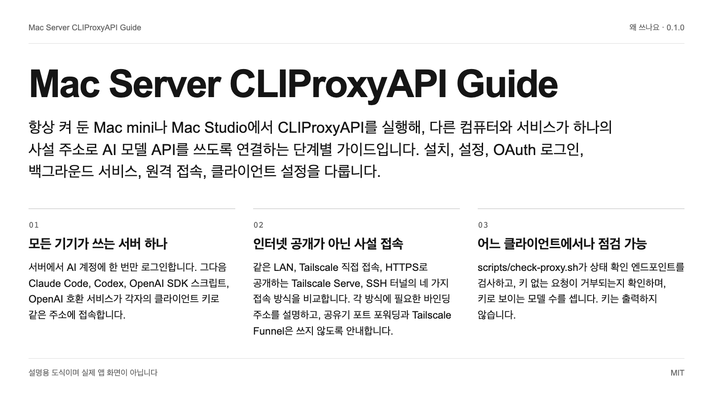
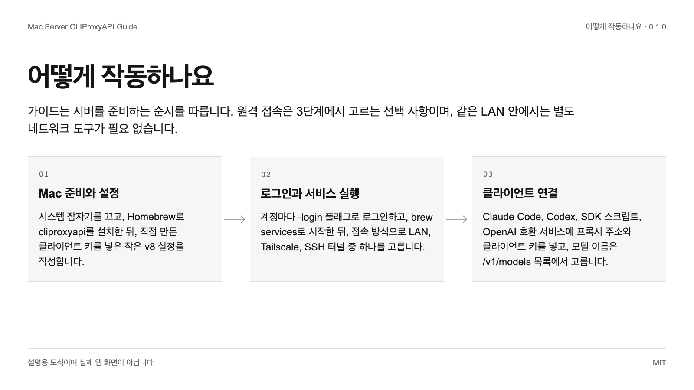
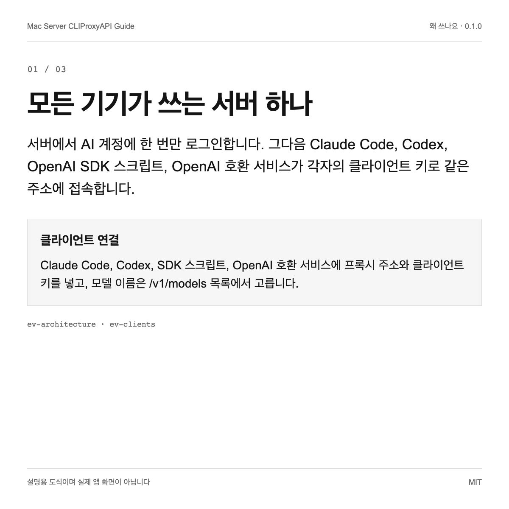
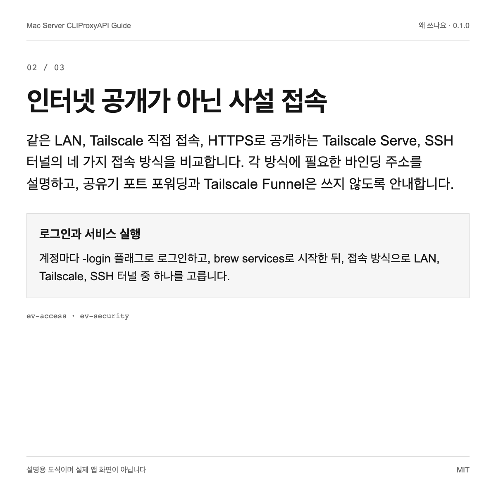
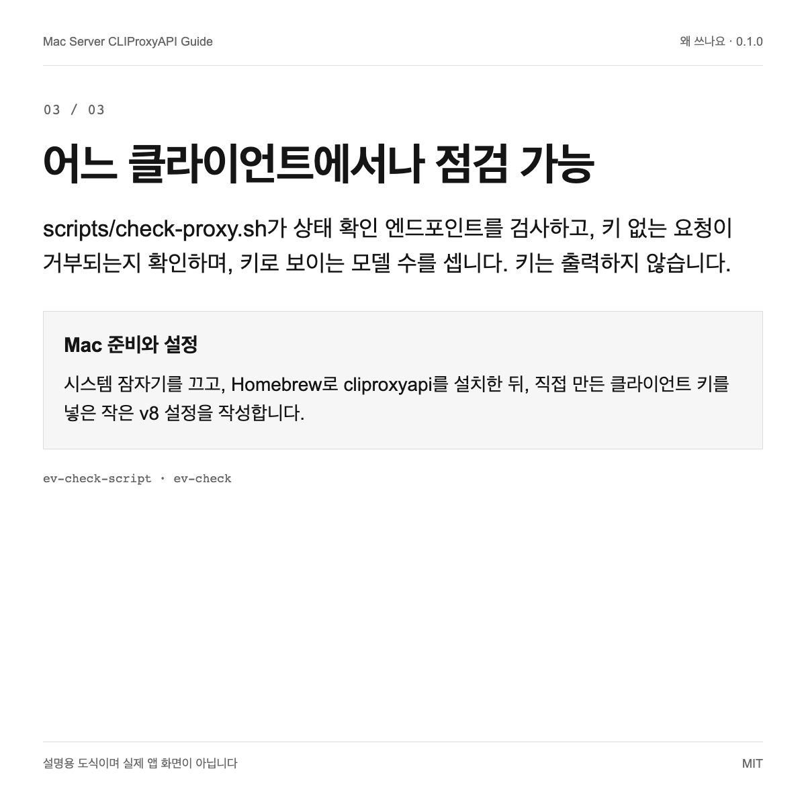

# Mac Server CLIProxyAPI Guide

항상 켜 둔 Mac mini나 Mac Studio에서 CLIProxyAPI를 실행해, 다른 컴퓨터와 서비스가 하나의 사설 주소로 AI 모델 API를 쓰도록 연결하는 단계별 가이드입니다. 설치, 설정, OAuth 로그인, 백그라운드 서비스, 원격 접속, 클라이언트 설정을 다룹니다.

[English](README.md) | **한국어** | [日本語](README.ja.md) | [简体中文](README.zh.md)



0.1.0 · MIT

## 왜 쓰나요

| | |
| --- | --- |
| 모든 기기가 쓰는 서버 하나 | 서버에서 AI 계정에 한 번만 로그인합니다. 그다음 Claude Code, Codex, OpenAI SDK 스크립트, OpenAI 호환 서비스가 각자의 클라이언트 키로 같은 주소에 접속합니다. |
| 인터넷 공개가 아닌 사설 접속 | 같은 LAN, Tailscale 직접 접속, HTTPS로 공개하는 Tailscale Serve, SSH 터널의 네 가지 접속 방식을 비교합니다. 각 방식에 필요한 바인딩 주소를 설명하고, 공유기 포트 포워딩과 Tailscale Funnel은 쓰지 않도록 안내합니다. |
| 어느 클라이언트에서나 점검 가능 | scripts/check-proxy.sh가 상태 확인 엔드포인트를 검사하고, 키 없는 요청이 거부되는지 확인하며, 키로 보이는 모델 수를 셉니다. 키는 출력하지 않습니다. |

## 빠른 시작

Homebrew가 설치된 Apple Silicon Mac mini 또는 Mac Studio와 CLIProxyAPI가 지원하는 계정이 필요합니다. 서비스를 시작하기 전에 $(brew --prefix)/etc/cliproxyapi.conf의 예시 키를 직접 만든 클라이언트 키로 바꿉니다(docs/guide.ko.md 5장). 마지막 명령은 이 저장소를 클론한 폴더에서 실행합니다.

```text
brew install cliproxyapi
cliproxyapi -claude-login
brew services start cliproxyapi
PROXY_URL=http://127.0.0.1:8317 PROXY_KEY=<client-key> ./scripts/check-proxy.sh
```

점검 결과로 상태 확인, 키 없는 요청 거부, 모델 목록에 각각 PASS가 출력되고 마지막에 ALL CHECKS PASSED가 출력됩니다.

## 어떻게 작동하나요

가이드는 서버를 준비하는 순서를 따릅니다. 원격 접속은 3단계에서 고르는 선택 사항이며, 같은 LAN 안에서는 별도 네트워크 도구가 필요 없습니다.



### Mac 준비와 설정

시스템 잠자기를 끄고, Homebrew로 cliproxyapi를 설치한 뒤, 직접 만든 클라이언트 키를 넣은 작은 v8 설정을 작성합니다.

### 로그인과 서비스 실행

계정마다 -login 플래그로 로그인하고, brew services로 시작한 뒤, 접속 방식으로 LAN, Tailscale, SSH 터널 중 하나를 고릅니다.

### 클라이언트 연결

Claude Code, Codex, SDK 스크립트, OpenAI 호환 서비스에 프록시 주소와 클라이언트 키를 넣고, 모델 이름은 /v1/models 목록에서 고릅니다.

## 사용 예시

### 집 안의 AI 게이트웨이

거실의 Mac mini가 같은 LAN의 노트북과 데스크톱에 API를 제공합니다.

### 밖에서도 내 기기만

Tailscale을 쓰면 인터넷에 포트를 열지 않고도 밖에서 노트북으로 서버에 접속할 수 있습니다.

### 자동화 도구 연결

n8n, Open WebUI, 직접 만든 스크립트가 OpenAI 호환 Base URL과 전용 키로 접속합니다.







## 한계와 개인정보

- 명령과 설정 키는 CLIProxyAPI v8.0.76 소스와 Homebrew formula로 확인했습니다. 이 가이드를 위해 전체 절차를 실제 서버에서 다시 실행하지는 않았습니다.

- CLIProxyAPI는 자주 바뀝니다. 다른 버전에서는 플래그, 키 이름, Codex 설정 형식이 다를 수 있습니다.

- 구독 계정을 프록시로 쓰는 것은 각 제공자의 약관을 따라야 합니다. 다른 사람과 계정을 나눠 쓰면 약관 위반이 될 수 있습니다.

- 서버는 OAuth 토큰을 ~/.cli-proxy-api에 저장합니다. 이 폴더나 클라이언트 키를 가진 사람은 내 계정 한도를 쓸 수 있습니다.

## 검증 상태

- **실행 확인**: tests/run.sh를 로컬에서 실행했습니다. shellcheck, 로컬 stub을 상대로 한 check-proxy.sh(정상, 잘못된 키, 키 없이 통과, 모델 없음, 서버 꺼짐), 예시 설정, 문서 링크, 영어·한국어 일치, 상류 플래그 목록, 개인정보 검사가 모두 통과했습니다.
- **코드 확인**: 로그인 플래그, 키 헤더, API 경로, 기본 포트, Homebrew 설정 경로는 상류 커밋 7df5607의 소스와 formula에서 읽어 확인했습니다.
- **문서 기준**: 미검증: 실제 계정으로 CLIProxyAPI 실행, 원격 접속, 각 클라이언트 연동.

## 다음 단계

전체 가이드는 docs/guide.ko.md(한국어) 또는 docs/guide.md(영어)에서 읽고, 연결한 클라이언트마다 scripts/check-proxy.sh로 점검합니다.

<details>
<summary>근거 목록</summary>

[JSON](docs/showcase/sources.json)

- `ev-scope`: `docs/guide.md`, L7–L7 (문서 기준)
- `ev-architecture`: `docs/guide.md`, L25–L46 (문서 기준)
- `ev-awake`: `docs/guide.md`, L58–L72 (문서 기준)
- `ev-install`: `docs/guide.md`, L74–L101 (코드 확인)
- `ev-config`: `docs/guide.md`, L103–L142 (코드 확인)
- `ev-login`: `docs/guide.md`, L144–L172 (코드 확인)
- `ev-service`: `docs/guide.md`, L174–L192 (코드 확인)
- `ev-check`: `docs/guide.md`, L194–L210 (문서 기준)
- `ev-access`: `docs/guide.md`, L212–L224 (문서 기준)
- `ev-clients`: `docs/guide.md`, L226–L286 (문서 기준)
- `ev-security`: `docs/guide.md`, L288–L295 (문서 기준)
- `ev-example-config`: `examples/config.server.yaml`, L1–L29 (코드 확인)
- `ev-check-script`: `scripts/check-proxy.sh`, L1–L52 (코드 확인)
- `ev-tests`: `tests/run.sh`, L1–L134 (실행 확인)

- `one-server` → `ev-architecture`, `ev-clients`
- `private-access` → `ev-access`, `ev-security`
- `checkable` → `ev-check-script`, `ev-check`
- `flow-install` → `ev-awake`, `ev-install`, `ev-config`, `ev-example-config`
- `flow-run` → `ev-login`, `ev-service`, `ev-access`
- `flow-connect` → `ev-clients`, `ev-check`
- `home-lab` → `ev-access`
- `away` → `ev-access`, `ev-security`
- `automation` → `ev-clients`
- `not-rerun` → `ev-scope`
- `versions` → `ev-scope`, `ev-clients`
- `terms` → `ev-security`
- `tokens` → `ev-config`, `ev-security`
- `repo-tests` → `ev-tests`
- `source-checked` → `ev-install`, `ev-login`, `ev-config`
- `live-server` → `ev-scope`
- `quickstart` → `ev-install`, `ev-login`, `ev-service`, `ev-check-script`

</details>
