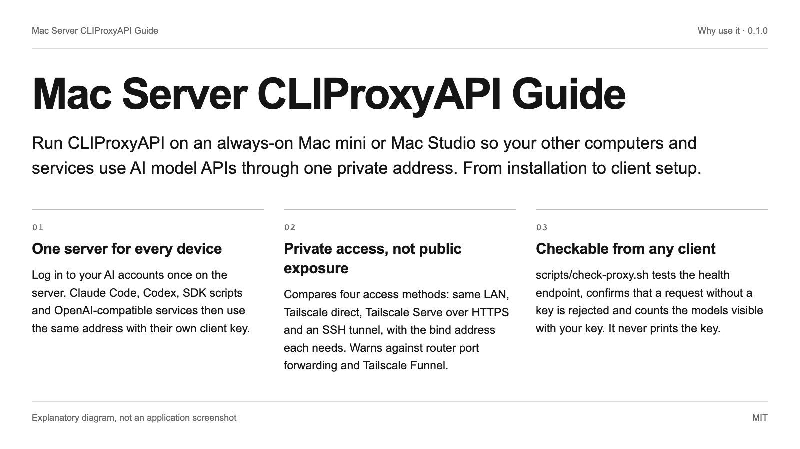
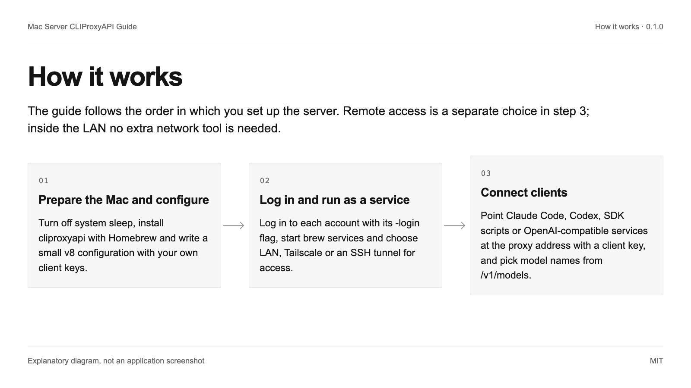
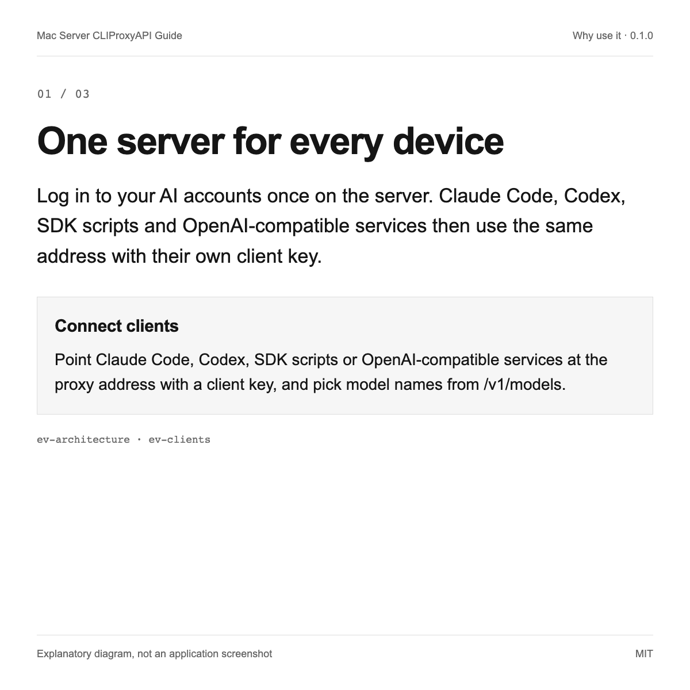
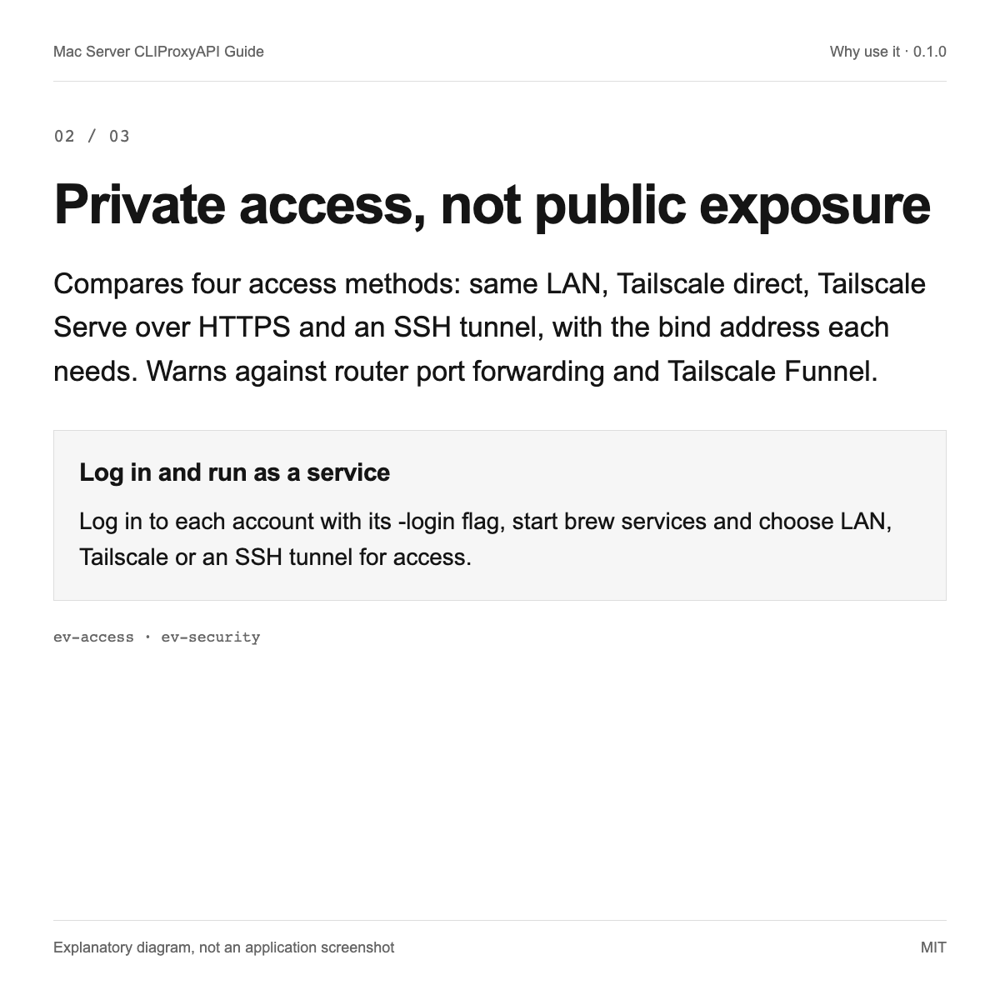
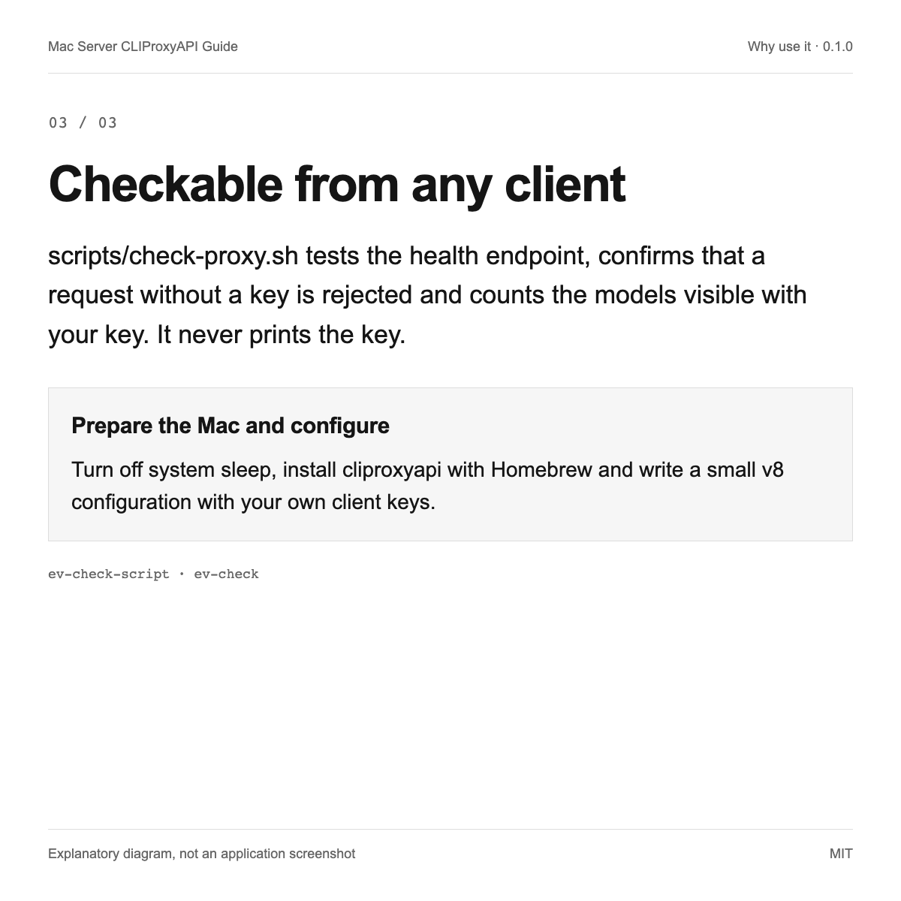

# Mac Server CLIProxyAPI Guide

Run CLIProxyAPI on an always-on Mac mini or Mac Studio so your other computers and services use AI model APIs through one private address. From installation to client setup.

**English** | [한국어](README.ko.md) | [日本語](README.ja.md) | [简体中文](README.zh.md)



0.1.0 · MIT

## Why use it

| | |
| --- | --- |
| One server for every device | Log in to your AI accounts once on the server. Claude Code, Codex, SDK scripts and OpenAI-compatible services then use the same address with their own client key. |
| Private access, not public exposure | Compares four access methods: same LAN, Tailscale direct, Tailscale Serve over HTTPS and an SSH tunnel, with the bind address each needs. Warns against router port forwarding and Tailscale Funnel. |
| Checkable from any client | scripts/check-proxy.sh tests the health endpoint, confirms that a request without a key is rejected and counts the models visible with your key. It never prints the key. |

## Quick start

An Apple Silicon Mac mini or Mac Studio with Homebrew, and an account that CLIProxyAPI supports. Before starting the service, replace the template keys in $(brew --prefix)/etc/cliproxyapi.conf with your own client keys (docs/guide.md, section 5). Run the last command from a clone of this repository.

```text
brew install cliproxyapi
cliproxyapi -claude-login
brew services start cliproxyapi
PROXY_URL=http://127.0.0.1:8317 PROXY_KEY=<client-key> ./scripts/check-proxy.sh
```

The check prints PASS for the health endpoint, the rejected request without a key and the model list, then ALL CHECKS PASSED.

## How it works

The guide follows the order in which you set up the server. Remote access is a separate choice in step 3; inside the LAN no extra network tool is needed.



### Prepare the Mac and configure

Turn off system sleep, install cliproxyapi with Homebrew and write a small v8 configuration with your own client keys.

### Log in and run as a service

Log in to each account with its -login flag, start brew services and choose LAN, Tailscale or an SSH tunnel for access.

### Connect clients

Point Claude Code, Codex, SDK scripts or OpenAI-compatible services at the proxy address with a client key, and pick model names from /v1/models.

## Use cases

### A home AI gateway

A Mac mini in the living room serves your laptop and desktop over the LAN.

### Your own devices, away from home

With Tailscale, your laptop reaches the server from outside without opening a port to the internet.

### Automation tools

n8n, Open WebUI or your scripts use the OpenAI-compatible base URL and a dedicated key.







## Limits and privacy

- Commands and keys were checked against the CLIProxyAPI v8.0.76 source and the Homebrew formula. The full procedure has not been re-run on a real server for this guide.

- CLIProxyAPI changes often. Flags, key names and the Codex configuration format can differ in other versions.

- Using subscription accounts through a proxy is subject to each provider's terms. Sharing an account with other people can break them.

- The server stores OAuth tokens in ~/.cli-proxy-api. Anyone with that folder or a client key can use your account limits.

## Verification

- **Execution verified**: tests/run.sh ran locally: shellcheck, check-proxy.sh against a local stub (good, wrong key, open, empty, down), example config, documentation links, en/ko parity, upstream flag list and privacy scan all passed.
- **Source inspected**: Login flags, key headers, API routes, the default port and the Homebrew configuration path were read in the upstream source at commit 7df5607 and in the formula.
- **Documented**: Not verified: running CLIProxyAPI with real accounts, remote access and each client integration.

## Next steps

Read the full guide in docs/guide.md (English) or docs/guide.ko.md (Korean), then run scripts/check-proxy.sh from each client you connect.

<details>
<summary>Source map</summary>

[JSON](docs/showcase/sources.json)

- `ev-scope`: `docs/guide.md`, L7–L7 (Documented)
- `ev-architecture`: `docs/guide.md`, L25–L46 (Documented)
- `ev-awake`: `docs/guide.md`, L58–L72 (Documented)
- `ev-install`: `docs/guide.md`, L74–L101 (Source inspected)
- `ev-config`: `docs/guide.md`, L103–L142 (Source inspected)
- `ev-login`: `docs/guide.md`, L144–L172 (Source inspected)
- `ev-service`: `docs/guide.md`, L174–L192 (Source inspected)
- `ev-check`: `docs/guide.md`, L194–L210 (Documented)
- `ev-access`: `docs/guide.md`, L212–L224 (Documented)
- `ev-clients`: `docs/guide.md`, L226–L288 (Documented)
- `ev-security`: `docs/guide.md`, L290–L297 (Documented)
- `ev-example-config`: `examples/config.server.yaml`, L1–L29 (Source inspected)
- `ev-check-script`: `scripts/check-proxy.sh`, L1–L52 (Source inspected)
- `ev-tests`: `tests/run.sh`, L1–L134 (Execution verified)

- `one-server` → `ev-architecture`, `ev-clients`
- `private-access` → `ev-access`, `ev-security`
- `checkable` → `ev-check-script`, `ev-check`
- `flow-install` → `ev-awake`, `ev-install`, `ev-config`, `ev-example-config`
- `flow-run` → `ev-login`, `ev-service`, `ev-access`
- `flow-connect` → `ev-clients`, `ev-check`
- `home-lab` → `ev-access`
- `away` → `ev-access`, `ev-security`
- `automation` → `ev-clients`
- `not-rerun` → `ev-scope`
- `versions` → `ev-scope`, `ev-clients`
- `terms` → `ev-security`
- `tokens` → `ev-config`, `ev-security`
- `repo-tests` → `ev-tests`
- `source-checked` → `ev-install`, `ev-login`, `ev-config`
- `live-server` → `ev-scope`
- `quickstart` → `ev-install`, `ev-login`, `ev-service`, `ev-check-script`

</details>
