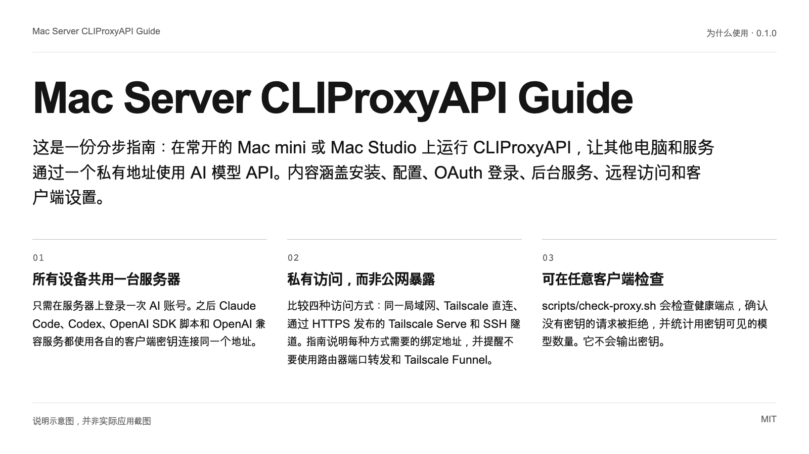
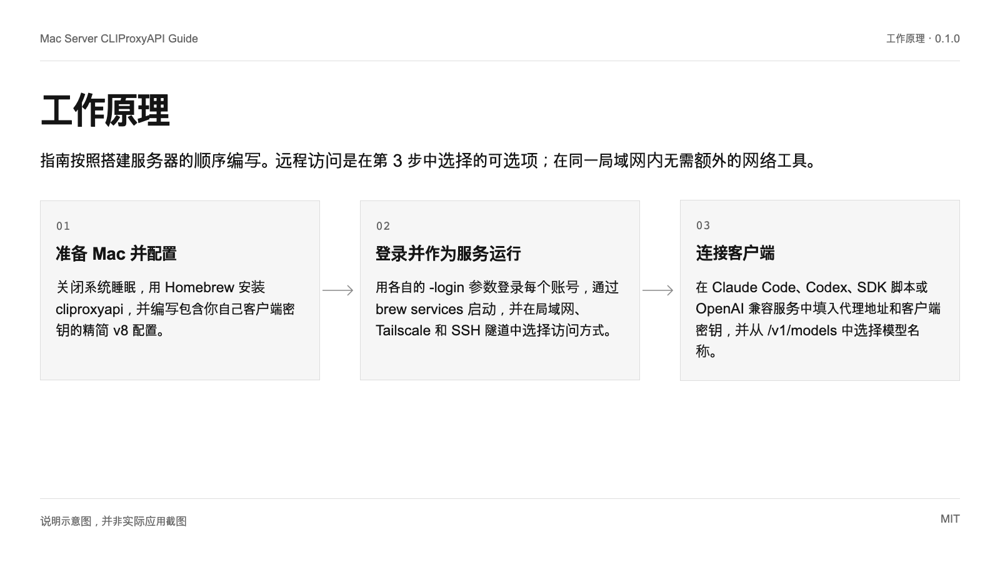
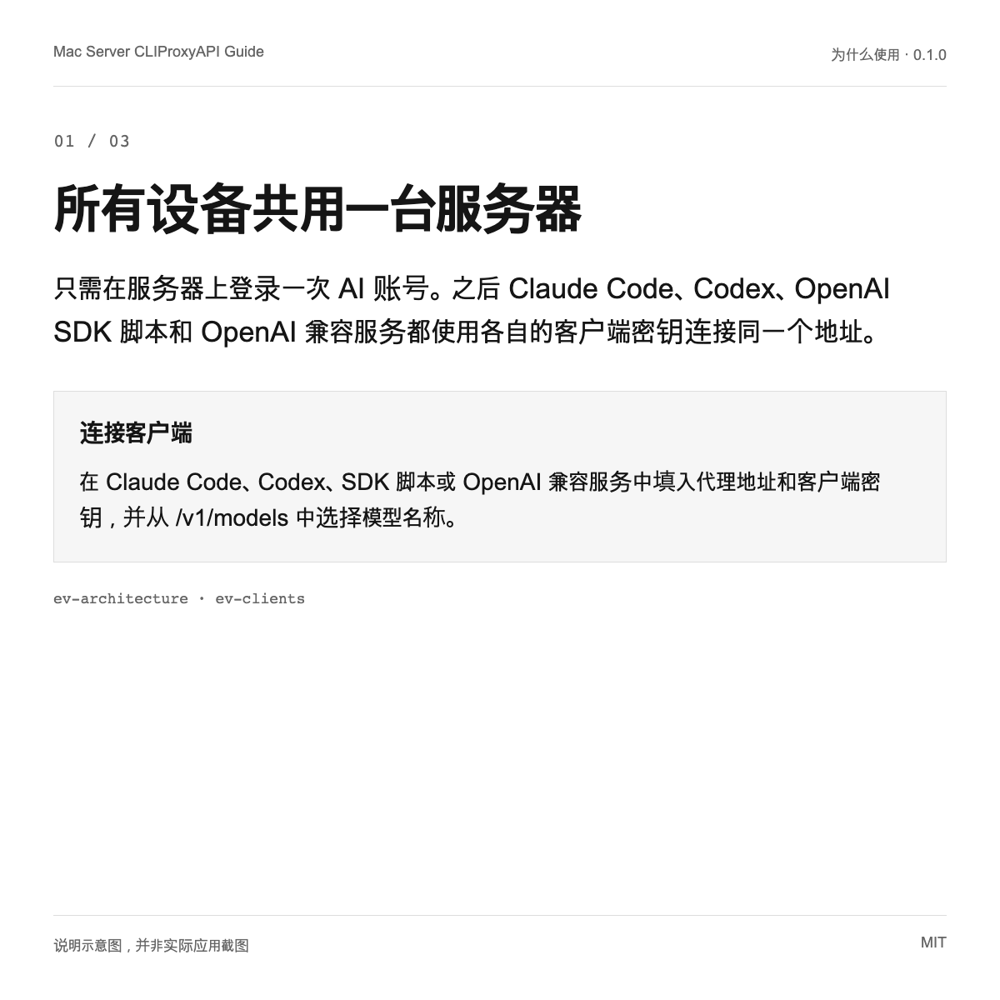
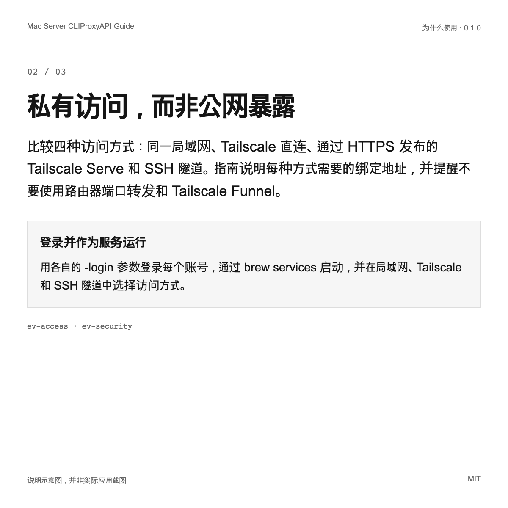
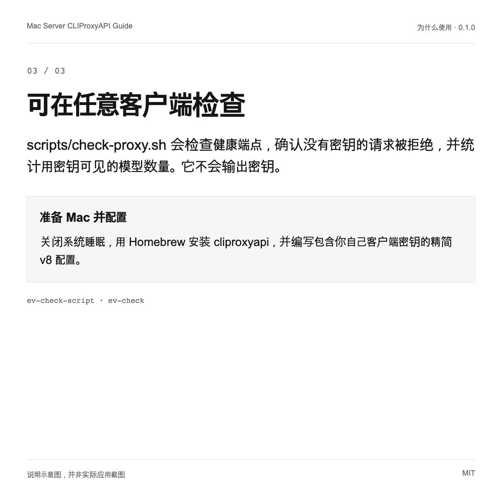

# Mac Server CLIProxyAPI Guide

这是一份分步指南：在常开的 Mac mini 或 Mac Studio 上运行 CLIProxyAPI，让其他电脑和服务通过一个私有地址使用 AI 模型 API。内容涵盖安装、配置、OAuth 登录、后台服务、远程访问和客户端设置。

[English](README.md) | [한국어](README.ko.md) | [日本語](README.ja.md) | **简体中文**



0.1.0 · MIT

## 为什么使用

| | |
| --- | --- |
| 所有设备共用一台服务器 | 只需在服务器上登录一次 AI 账号。之后 Claude Code、Codex、OpenAI SDK 脚本和 OpenAI 兼容服务都使用各自的客户端密钥连接同一个地址。 |
| 私有访问，而非公网暴露 | 比较四种访问方式：同一局域网、Tailscale 直连、通过 HTTPS 发布的 Tailscale Serve 和 SSH 隧道。指南说明每种方式需要的绑定地址，并提醒不要使用路由器端口转发和 Tailscale Funnel。 |
| 可在任意客户端检查 | scripts/check-proxy.sh 会检查健康端点，确认没有密钥的请求被拒绝，并统计用密钥可见的模型数量。它不会输出密钥。 |

## 快速开始

需要安装了 Homebrew 的 Apple Silicon Mac mini 或 Mac Studio，以及 CLIProxyAPI 支持的账号。启动服务前，请把 $(brew --prefix)/etc/cliproxyapi.conf 中的示例密钥替换为你自己生成的客户端密钥（docs/guide.md 第 5 节）。最后一条命令在本仓库的克隆目录中运行。

```text
brew install cliproxyapi
cliproxyapi -claude-login
brew services start cliproxyapi
PROXY_URL=http://127.0.0.1:8317 PROXY_KEY=<client-key> ./scripts/check-proxy.sh
```

检查会对健康端点、无密钥请求被拒绝和模型列表分别输出 PASS，最后输出 ALL CHECKS PASSED。

## 工作原理

指南按照搭建服务器的顺序编写。远程访问是在第 3 步中选择的可选项；在同一局域网内无需额外的网络工具。



### 准备 Mac 并配置

关闭系统睡眠，用 Homebrew 安装 cliproxyapi，并编写包含你自己客户端密钥的精简 v8 配置。

### 登录并作为服务运行

用各自的 -login 参数登录每个账号，通过 brew services 启动，并在局域网、Tailscale 和 SSH 隧道中选择访问方式。

### 连接客户端

在 Claude Code、Codex、SDK 脚本或 OpenAI 兼容服务中填入代理地址和客户端密钥，并从 /v1/models 中选择模型名称。

## 使用场景

### 家用 AI 网关

客厅里的 Mac mini 通过局域网为笔记本和台式机提供 API。

### 外出时也仅限自己的设备

使用 Tailscale，笔记本在外也能连接服务器，无需向互联网开放端口。

### 连接自动化工具

n8n、Open WebUI 或你的脚本使用 OpenAI 兼容的 Base URL 和专用密钥接入。







## 限制与隐私

- 命令和配置键已对照 CLIProxyAPI v8.0.76 源码和 Homebrew formula 核对。本指南未在真实服务器上重新执行完整流程。

- CLIProxyAPI 更新频繁。其他版本中的参数、键名和 Codex 配置格式可能不同。

- 通过代理使用订阅账号须遵守各提供商的条款。与他人共享账号可能违反条款。

- 服务器把 OAuth 令牌保存在 ~/.cli-proxy-api。拥有该文件夹或客户端密钥的人都能使用你的账号额度。

## 验证状态

- **已验证运行**: 已在本地运行 tests/run.sh：shellcheck、针对本地 stub 的 check-proxy.sh（正常、错误密钥、无密钥放行、无模型、服务器关闭）、示例配置、文档链接、英韩一致性、上游参数列表和隐私扫描全部通过。
- **已检查代码**: 登录参数、密钥请求头、API 路径、默认端口和 Homebrew 配置路径均已在上游提交 7df5607 的源码和 formula 中核对。
- **文档说明**: 未验证：使用真实账号运行 CLIProxyAPI、远程访问以及各客户端集成。

## 下一步

完整指南见 docs/guide.md（英文）或 docs/guide.ko.md（韩文）；之后在每个已连接的客户端上运行 scripts/check-proxy.sh。

<details>
<summary>依据列表</summary>

[JSON](docs/showcase/sources.json)

- `ev-scope`: `docs/guide.md`, L7–L7 (文档说明)
- `ev-architecture`: `docs/guide.md`, L25–L46 (文档说明)
- `ev-awake`: `docs/guide.md`, L58–L72 (文档说明)
- `ev-install`: `docs/guide.md`, L74–L101 (已检查代码)
- `ev-config`: `docs/guide.md`, L103–L142 (已检查代码)
- `ev-login`: `docs/guide.md`, L144–L172 (已检查代码)
- `ev-service`: `docs/guide.md`, L174–L192 (已检查代码)
- `ev-check`: `docs/guide.md`, L194–L210 (文档说明)
- `ev-access`: `docs/guide.md`, L212–L224 (文档说明)
- `ev-clients`: `docs/guide.md`, L226–L288 (文档说明)
- `ev-security`: `docs/guide.md`, L290–L297 (文档说明)
- `ev-example-config`: `examples/config.server.yaml`, L1–L29 (已检查代码)
- `ev-check-script`: `scripts/check-proxy.sh`, L1–L52 (已检查代码)
- `ev-tests`: `tests/run.sh`, L1–L134 (已验证运行)

- `one-server` → `ev-architecture`, `ev-clients`
- `private-access` → `ev-access`, `ev-security`
- `checkable` → `ev-check-script`, `ev-check`
- `flow-install` → `ev-awake`, `ev-install`, `ev-config`, `ev-example-config`
- `flow-run` → `ev-login`, `ev-service`, `ev-access`
- `flow-connect` → `ev-clients`, `ev-check`
- `home-lab` → `ev-access`
- `away` → `ev-access`, `ev-security`
- `automation` → `ev-clients`
- `not-rerun` → `ev-scope`
- `versions` → `ev-scope`, `ev-clients`
- `terms` → `ev-security`
- `tokens` → `ev-config`, `ev-security`
- `repo-tests` → `ev-tests`
- `source-checked` → `ev-install`, `ev-login`, `ev-config`
- `live-server` → `ev-scope`
- `quickstart` → `ev-install`, `ev-login`, `ev-service`, `ev-check-script`

</details>
