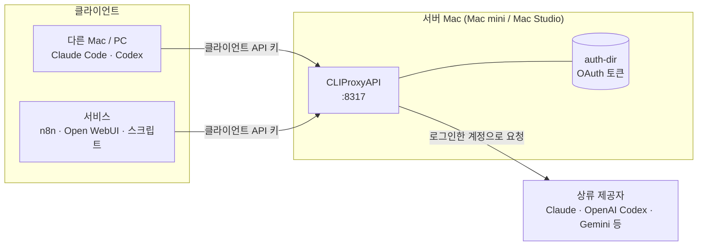

# Mac mini·Mac Studio에 CLIProxyAPI 서버 띄우기: 설치부터 클라이언트 연결까지

[English](guide.md) | 한국어

이 문서는 집이나 사무실의 Mac mini 또는 Mac Studio를 항상 켜 두는 서버로 쓰고, 그 위에서 [CLIProxyAPI](https://github.com/router-for-me/CLIProxyAPI)를 실행해 다른 컴퓨터와 서비스가 하나의 주소로 AI 모델 API를 쓰도록 연결하는 절차를 설명합니다.

> 근거 범위: 명령과 설정 키는 CLIProxyAPI `v8.0.76`(커밋 `7df5607`)의 소스, `config.example.yaml`, Homebrew 공식 formula를 읽고 확인했습니다. 이 저장소의 작성자는 이 절차 전체를 실제 서버에서 다시 실행해 확인하지 않았습니다. 버전이 바뀌면 키 이름과 플래그가 달라질 수 있으니 상류 문서([help.router-for.me](https://help.router-for.me/))도 함께 확인하십시오.

## 목차

1. [전체 구성](#1-전체-구성)
2. [준비물](#2-준비물)
3. [서버 Mac을 항상 켜 두기](#3-서버-mac을-항상-켜-두기)
4. [CLIProxyAPI 설치](#4-cliproxyapi-설치)
5. [설정 파일 작성](#5-설정-파일-작성)
6. [계정 로그인(OAuth)](#6-계정-로그인oauth)
7. [백그라운드 서비스로 실행](#7-백그라운드-서비스로-실행)
8. [서버에서 동작 확인](#8-서버에서-동작-확인)
9. [다른 컴퓨터에서 접속하는 방법](#9-다른-컴퓨터에서-접속하는-방법)
10. [클라이언트와 서비스 연결](#10-클라이언트와-서비스-연결)
11. [보안 점검표](#11-보안-점검표)
12. [업데이트·백업·제거](#12-업데이트백업제거)
13. [문제 해결](#13-문제-해결)

## 1. 전체 구성



- **서버**: CLIProxyAPI가 기본 포트 `8317`에서 OpenAI·Claude·Gemini 호환 API를 제공합니다.
- **클라이언트 API 키**: 클라이언트가 프록시에 접속할 때 쓰는 키입니다. 상류 제공자의 키가 아니며, 설정 파일의 `access.api-keys`에 직접 정합니다.
- **auth-dir**: 서버에서 로그인한 계정의 OAuth 토큰이 저장되는 폴더입니다. 기본값은 `~/.cli-proxy-api`입니다.

## 2. 준비물

| 항목 | 설명 |
|---|---|
| 서버 Mac | Apple Silicon Mac mini 또는 Mac Studio. 유선 LAN 연결을 권장합니다 |
| Homebrew | [brew.sh](https://brew.sh/)의 안내대로 설치합니다 |
| 사용할 계정 | Claude, ChatGPT(Codex) 등 CLIProxyAPI가 지원하는 계정입니다. 각 서비스의 약관을 확인하십시오 |
| 원격 접속 수단(선택) | 같은 네트워크 밖에서 접속하려면 [Tailscale](https://tailscale.com/) 같은 사설 네트워크를 권장합니다 |
| 클라이언트 | 서버에 접속할 다른 Mac·PC 또는 서비스입니다 |

## 3. 서버 Mac을 항상 켜 두기

서버가 잠자기에 들어가면 클라이언트가 접속할 수 없습니다.

1. **시스템 설정 → 에너지**(또는 배터리/에너지 절약)에서 디스플레이가 꺼져도 자동으로 잠자기 상태가 되지 않도록 설정하고, 정전 후 자동으로 켜지도록 설정합니다. 메뉴 이름은 macOS 버전에 따라 다릅니다.
2. 터미널에서는 `pmset`으로 같은 설정을 할 수 있습니다.

   ```sh
   sudo pmset -a sleep 0          # 시스템 잠자기 끄기 (0 = 사용 안 함)
   sudo pmset -a autorestart 1    # 정전 후 자동 재시작
   sudo pmset -a womp 1           # 유선 네트워크 매직 패킷으로 깨우기
   pmset -g                       # 현재 값 확인
   ```

3. **자동 로그인**: 7장의 `brew services`는 사용자 로그인 시 시작되는 LaunchAgent로 실행됩니다. 재부팅 후에도 자동으로 올라오게 하려면 **시스템 설정 → 사용자 및 그룹**에서 서버 사용자의 자동 로그인을 켭니다. FileVault가 켜져 있으면 자동 로그인을 쓸 수 없으며, 재부팅 후 한 번은 직접 로그인해야 합니다.

## 4. CLIProxyAPI 설치

### 방법 A: Homebrew (권장)

Homebrew 공식 저장소(homebrew-core)에 `cliproxyapi` formula가 있습니다.

```sh
brew install cliproxyapi
brew info cliproxyapi        # 설치 버전과 서비스 안내 확인
```

Homebrew로 설치하면 다음이 정해집니다.

- 실행 파일: `$(brew --prefix)/bin/cliproxyapi`
- 기본 설정 파일: `$(brew --prefix)/etc/cliproxyapi.conf` (설치할 때 `config.example.yaml`이 이 이름으로 복사됩니다. Apple Silicon에서는 보통 `/opt/homebrew/etc/cliproxyapi.conf`입니다)

### 방법 B: GitHub 릴리스 바이너리

Homebrew를 쓰지 않으려면 [릴리스 페이지](https://github.com/router-for-me/CLIProxyAPI/releases)에서 `CLIProxyAPI_<버전>_darwin_aarch64.tar.gz`와 `checksums.txt`를 받아 체크섬을 확인합니다. 압축 안의 실행 파일 이름은 `cli-proxy-api`입니다.

```sh
shasum -a 256 CLIProxyAPI_*_darwin_aarch64.tar.gz
grep darwin_aarch64 checksums.txt     # 두 값이 같아야 합니다
tar xzf CLIProxyAPI_*_darwin_aarch64.tar.gz
./cli-proxy-api -config ./config.yaml
```

이 방법은 `-config`로 설정 파일 경로를 직접 지정하고, 상시 실행은 직접 launchd에 등록해야 합니다. 이 문서의 나머지는 방법 A를 기준으로 설명합니다.

## 5. 설정 파일 작성

기본 설정 파일은 예시 값이 많은 긴 템플릿입니다. 처음에는 필요한 키만 담은 작은 파일로 시작하는 편이 관리하기 쉽습니다. 이 저장소의 [`examples/config.server.yaml`](../examples/config.server.yaml)을 바탕으로 작성합니다.

```sh
CONF="$(brew --prefix)/etc/cliproxyapi.conf"
cp "$CONF" "$CONF.orig"                     # 원본 템플릿 백업
openssl rand -hex 32                        # 클라이언트 API 키 생성(클라이언트마다 하나씩 권장)
```

```yaml
config-version: 8

server:
  host: ""        # 모든 인터페이스. 서버 자신만 쓰려면 "127.0.0.1"
  port: 8317

management:
  allow-remote: false
  secret-key: ""  # 비워 두면 관리 API가 꺼집니다(404)

access:
  api-keys:
    - "<클라이언트-1-키>"
    - "<클라이언트-2-키>"

oauth:
  auth-dir: "~/.cli-proxy-api"
```

| 키 | 의미 | 권장 |
|---|---|---|
| `server.host` | 바인딩할 주소입니다. `""`는 IPv4·IPv6의 모든 인터페이스, `"127.0.0.1"`은 서버 자신만입니다 | 9장의 접속 방식에 맞춰 고릅니다 |
| `server.port` | 서비스 포트입니다. 기본값은 `8317`입니다 | 그대로 둡니다 |
| `access.api-keys` | 클라이언트가 보내야 하는 키 목록입니다. 상류 제공자 키와 다릅니다 | 예시 값(`your-api-key-1` 등)을 반드시 지우고 직접 만든 긴 키를 넣습니다 |
| `management.secret-key` | 관리 API 키입니다. 비우면 관리 API가 꺼집니다 | 필요할 때만 설정합니다 |
| `management.allow-remote` | `false`이면 관리 API는 서버 자신에서만 접근할 수 있습니다 | `false` 유지 |
| `oauth.auth-dir` | OAuth 토큰 저장 폴더입니다 | 기본값 유지, 백업 대상 |

클라이언트는 키를 `Authorization: Bearer <키>`, `x-api-key`, `x-goog-api-key` 헤더 중 하나로 보냅니다(CLIProxyAPI `internal/access/config_access/provider.go`에서 확인). 보통은 각 클라이언트가 자기 방식대로 알아서 보냅니다.

## 6. 계정 로그인(OAuth)

서버에서 쓸 계정마다 한 번씩 로그인합니다. 토큰은 `auth-dir`에 저장되고, 같은 제공자의 계정을 여러 개 로그인하면 번갈아 사용합니다(round-robin).

| 제공자 | 명령 |
|---|---|
| Claude | `cliproxyapi -claude-login` |
| OpenAI Codex | `cliproxyapi -codex-login` |
| OpenAI Codex (브라우저 없는 서버) | `cliproxyapi -codex-device-login` |
| Antigravity (Google) | `cliproxyapi -antigravity-login` |
| 그 밖 | `-kimi-login`, `-xai-login`, `-devin-login`, `-meta-login` |

서버 화면 앞에서 로그인하면 브라우저가 열리고, 로그인을 마치면 토큰이 저장됩니다.

**SSH로만 접속하는 서버라면** 다음 중 하나를 씁니다.

- **기기 코드 방식**: Codex는 `-codex-device-login`으로 다른 기기의 브라우저에서 코드를 입력해 로그인합니다.
- **브라우저 자동 실행 끄기 + 포트 전달**: `-no-browser`를 붙이면 로그인 URL이 출력됩니다. 이 URL을 노트북 브라우저에서 열면 로그인 후 `localhost:<포트>`로 돌아오는데, 이 포트는 서버에서 기다리고 있습니다. URL의 `redirect_uri`에 적힌 포트를 SSH로 전달해 두면 노트북에서도 로그인을 끝낼 수 있습니다. 예를 들어 Antigravity의 기본 콜백 포트는 `51121`입니다.

  ```sh
  # 노트북에서
  ssh -L 51121:127.0.0.1:51121 <서버사용자>@<서버주소>
  # 서버 쪽 SSH 세션에서
  cliproxyapi -antigravity-login -no-browser
  ```

- `-oauth-callback-port <포트>`로 콜백 포트를 바꿀 수 있습니다.

> 주의: `brew services`로 실행되는 서비스와 같은 사용자 계정으로 로그인해야 같은 `~/.cli-proxy-api`를 씁니다.

## 7. 백그라운드 서비스로 실행

```sh
brew services start cliproxyapi      # 시작 + 로그인할 때 자동 시작 등록
brew services list                   # 상태 확인 (started 여부)
brew services restart cliproxyapi    # 설정을 바꾼 뒤 재시작
brew services stop cliproxyapi       # 중지
```

Homebrew formula의 서비스 정의는 `cliproxyapi`를 기본 설정 파일로 실행하고, 프로세스가 종료되면 다시 띄웁니다(`keep_alive true`).

로그를 파일로 남기려면 설정에 다음을 추가합니다.

```yaml
observability:
  logs:
    logging-to-file: true
    logs-max-total-size-mb: 200
```

## 8. 서버에서 동작 확인

서버 터미널에서 실행합니다.

```sh
curl -i http://127.0.0.1:8317/healthz
curl -s -H "Authorization: Bearer <클라이언트-1-키>" http://127.0.0.1:8317/v1/models
curl -s -o /dev/null -w '%{http_code}\n' http://127.0.0.1:8317/v1/models   # 키 없이 → 401이어야 정상
```

이 저장소의 [`scripts/check-proxy.sh`](../scripts/check-proxy.sh)는 같은 검사를 한 번에 합니다.

```sh
PROXY_URL=http://127.0.0.1:8317 PROXY_KEY=<클라이언트-1-키> ./scripts/check-proxy.sh
```

`/v1/models` 목록에 로그인한 계정의 모델이 보이면 준비가 끝난 것입니다. 클라이언트에서 쓸 모델 이름은 이 목록에서 고릅니다.

## 9. 다른 컴퓨터에서 접속하는 방법

| 방식 | `server.host` | 클라이언트 주소 | 적합한 경우 |
|---|---|---|---|
| A. 같은 LAN | `""` | `http://<서버-LAN-IP>:8317` | 집·사무실 안에서만 씁니다 |
| B. Tailscale 직접 접속 | `""` | `http://<서버-tailnet-이름 또는 100.x.y.z>:8317` | 밖에서도 내 기기끼리만 씁니다 |
| C. Tailscale Serve (HTTPS) | `"127.0.0.1"` | `https://<서버>.<tailnet>.ts.net` | 프록시는 서버 자신에만 열고, tailnet에는 HTTPS로만 공개합니다 |
| D. SSH 터널 | `"127.0.0.1"` | `http://127.0.0.1:8317` (클라이언트 쪽) | 한두 대의 기기에서 임시로 씁니다 |

- **A·B**: 서버의 LAN IP는 **시스템 설정 → 네트워크**에서 확인합니다. 공유기에서 DHCP 예약을 해 두면 주소가 바뀌지 않습니다. macOS 방화벽이 켜져 있으면 들어오는 연결 허용 여부를 묻는 창이 나올 수 있습니다.
- **C**: 서버에서 `tailscale serve --bg 8317`을 실행하면 `127.0.0.1:8317`을 tailnet 안에 HTTPS로 공개합니다. 처음 실행할 때 tailnet의 HTTPS 인증서 기능을 켜라는 안내가 나오면 따릅니다. 상태는 `tailscale serve status`로 확인합니다. 인터넷 전체에 공개하는 `tailscale funnel`은 쓰지 마십시오.
- **D**: 클라이언트에서 `ssh -N -L 8317:127.0.0.1:8317 <서버사용자>@<서버주소>`를 실행해 두는 동안만 접속됩니다.
- **공유기 포트 포워딩으로 인터넷에 직접 공개하지 마십시오.** 키가 유출되면 누구나 내 계정 한도를 쓰게 됩니다.

## 10. 클라이언트와 서비스 연결

아래의 `<PROXY>`는 9장에서 고른 주소(예: `http://192.168.0.10:8317`), `<KEY>`는 그 클라이언트용 키입니다. 모델 이름은 8장의 `/v1/models` 목록에서 고릅니다. 예시 파일은 [`examples/clients/`](../examples/clients/)에 있습니다.

### Claude Code

```sh
export ANTHROPIC_BASE_URL="<PROXY>"
export ANTHROPIC_AUTH_TOKEN="<KEY>"
claude
```

CLIProxyAPI는 `/v1/messages`(Claude 호환)를 제공합니다. Claude Code 화면에서 쓰는 모델 이름이 `/v1/models` 목록에 없으면 설정의 `oauth.model-alias`로 별칭을 만들 수 있습니다. Claude Code는 자동 모드 판정에 대화 모델과 다른 모델을 쓸 수 있으니, 상류 예시 문서([Claude Code with a Codex backend](https://github.com/router-for-me/CLIProxyAPI/tree/main/examples/claude-code-codex))도 확인하십시오.

### Codex CLI

`~/.codex/config.toml`에 OpenAI 호환 제공자를 추가합니다. Codex 설정 형식은 Codex 버전에 따라 달라질 수 있으니 Codex 공식 문서와 대조하십시오.

```toml
model_provider = "cliproxy"

[model_providers.cliproxy]
name = "CLIProxyAPI"
base_url = "<PROXY>/v1"
env_key = "CLIPROXY_API_KEY"
wire_api = "responses"
```

```sh
export CLIPROXY_API_KEY="<KEY>"
codex
```

### OpenAI SDK·스크립트

```python
from openai import OpenAI

client = OpenAI(base_url="<PROXY>/v1", api_key="<KEY>")
reply = client.chat.completions.create(
    model="<모델-이름>",
    messages=[{"role": "user", "content": "안녕하세요"}],
)
print(reply.choices[0].message.content)
```

```sh
curl -s "<PROXY>/v1/chat/completions" \
  -H "Authorization: Bearer <KEY>" -H "Content-Type: application/json" \
  -d '{"model":"<모델-이름>","messages":[{"role":"user","content":"hello"}]}'
```

### 그 밖의 서비스 (n8n, Open WebUI 등)

"OpenAI 호환(OpenAI-compatible)" 또는 "사용자 지정 Base URL" 설정이 있는 서비스라면 다음 값을 넣습니다.

- Base URL: `<PROXY>/v1`
- API Key: `<KEY>`
- 모델: `/v1/models` 목록의 이름

서비스가 Docker 컨테이너 안에서 돈다면, 컨테이너에서 본 서버 주소를 써야 합니다. 같은 Mac의 컨테이너라면 `127.0.0.1` 대신 `host.docker.internal`을 씁니다.

## 11. 보안 점검표

- [ ] `access.api-keys`에서 예시 키를 지우고 `openssl rand -hex 32` 같은 긴 무작위 키만 남겼습니다.
- [ ] 클라이언트마다 다른 키를 주어, 하나가 유출되면 그 키만 지울 수 있게 했습니다.
- [ ] 공유기 포트 포워딩이나 `tailscale funnel`로 인터넷에 공개하지 않았습니다.
- [ ] `management.secret-key`를 비워 두었거나, 쓴다면 `allow-remote: false`를 유지했습니다.
- [ ] `~/.cli-proxy-api`(OAuth 토큰)와 설정 파일을 다른 사람과 공유하지 않으며, Git 저장소에 넣지 않았습니다.
- [ ] 각 AI 서비스 약관을 확인했습니다. 구독 계정을 다른 사람과 나눠 쓰는 것은 약관 위반이 될 수 있습니다.

## 12. 업데이트·백업·제거

```sh
brew upgrade cliproxyapi && brew services restart cliproxyapi    # 업데이트

# 백업: 설정 파일과 토큰 폴더
cp "$(brew --prefix)/etc/cliproxyapi.conf" ~/cliproxyapi.conf.backup
tar czf ~/cli-proxy-api-auth.tgz -C ~ .cli-proxy-api
chmod 600 ~/cli-proxy-api-auth.tgz

# 제거
brew services stop cliproxyapi
brew uninstall cliproxyapi
rm -rf ~/.cli-proxy-api            # 토큰까지 지울 때만
```

`brew upgrade`는 이미 고친 설정 파일을 덮어쓰지 않는 것이 Homebrew의 일반적인 동작이지만, 업데이트 전에 설정 파일을 백업해 두는 편이 안전합니다.

## 13. 문제 해결

| 증상 | 확인할 점 |
|---|---|
| `401` 응답 | 키가 `access.api-keys`에 있는지, 앞뒤 공백 없이 보냈는지 확인합니다 |
| 서버에서는 되는데 다른 기기에서 `Connection refused` | `server.host`가 `"127.0.0.1"`이면 다른 기기에서 접속할 수 없습니다. 방식 A·B라면 `""`로 바꾸고 재시작합니다 |
| 다른 기기에서 시간 초과 | 서버 IP·Tailscale 연결·macOS 방화벽을 확인합니다 |
| 재부팅 후 응답 없음 | 자동 로그인 여부(FileVault 사용 시 불가)와 `brew services list` 상태를 확인합니다 |
| 밤사이 접속이 끊김 | `pmset -g`에서 `sleep`이 `0`인지 확인합니다 |
| `/v1/models`가 비어 있음 | 6장의 로그인을 서비스와 같은 사용자로 했는지, `auth-dir` 경로가 맞는지 확인합니다 |
| 설정을 바꿨는데 반영되지 않음 | `brew services restart cliproxyapi`로 재시작합니다 |
| 특정 모델 이름이 없다는 오류 | `/v1/models`의 이름을 쓰거나 `oauth.model-alias`로 별칭을 만듭니다 |

## 출처

- CLIProxyAPI 저장소, 커밋 [`7df5607`](https://github.com/router-for-me/CLIProxyAPI/tree/7df56074b252384d878ec4fca840552c6fb5236e): `README.md`, `config.example.yaml`, `cmd/server/main.go`(플래그), `internal/access/config_access/provider.go`(키 헤더), `internal/api/server_routes.go`(API 경로), `internal/auth/antigravity/constants.go`(콜백 포트). MIT 라이선스.
- Homebrew formula: [`Formula/c/cliproxyapi.rb`](https://github.com/Homebrew/homebrew-core/blob/HEAD/Formula/c/cliproxyapi.rb) (설정 파일 위치, 서비스 정의).
- macOS `man pmset`, `tailscale serve --help`.
