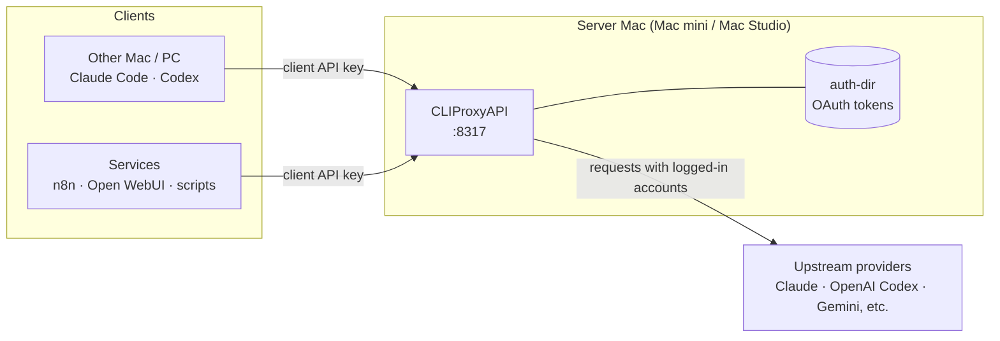

# Run a CLIProxyAPI server on a Mac mini or Mac Studio: from installation to client setup

English | [한국어](guide.ko.md)

This guide turns an always-on Mac mini or Mac Studio into a small server that runs [CLIProxyAPI](https://github.com/router-for-me/CLIProxyAPI), so other computers and services can use AI model APIs through one address.

> Evidence scope: the commands and configuration keys were checked against the CLIProxyAPI `v8.0.76` source (commit `7df5607`), its `config.example.yaml`, and the official Homebrew formula. The author of this repository has not re-run the whole procedure on a real server. Key names and flags can change between versions, so also check the upstream guides at [help.router-for.me](https://help.router-for.me/).

## Contents

1. [Architecture](#1-architecture)
2. [Requirements](#2-requirements)
3. [Keep the server Mac awake](#3-keep-the-server-mac-awake)
4. [Install CLIProxyAPI](#4-install-cliproxyapi)
5. [Write the configuration](#5-write-the-configuration)
6. [Log in to accounts (OAuth)](#6-log-in-to-accounts-oauth)
7. [Run as a background service](#7-run-as-a-background-service)
8. [Check it on the server](#8-check-it-on-the-server)
9. [Reach the server from other computers](#9-reach-the-server-from-other-computers)
10. [Connect clients and services](#10-connect-clients-and-services)
11. [Security checklist](#11-security-checklist)
12. [Update, back up, remove](#12-update-back-up-remove)
13. [Troubleshooting](#13-troubleshooting)

## 1. Architecture



- **Server**: CLIProxyAPI serves OpenAI-, Claude- and Gemini-compatible APIs on the default port `8317`.
- **Client API key**: the key a client sends to the proxy. It is not an upstream provider key. You choose it in `access.api-keys`.
- **auth-dir**: the folder that stores OAuth tokens for the accounts you log in to on the server. The default is `~/.cli-proxy-api`.

## 2. Requirements

| Item | Notes |
|---|---|
| Server Mac | Apple Silicon Mac mini or Mac Studio. A wired LAN connection is recommended |
| Homebrew | Install it as described at [brew.sh](https://brew.sh/) |
| Accounts | Claude, ChatGPT (Codex) or other accounts that CLIProxyAPI supports. Check each provider's terms |
| Remote access (optional) | A private network such as [Tailscale](https://tailscale.com/) for access outside your LAN |
| Clients | The other Macs, PCs or services that will connect |

## 3. Keep the server Mac awake

Clients cannot connect while the server sleeps.

1. In **System Settings → Energy** (the name varies by macOS version), prevent automatic sleep when the display is off and turn on automatic start after a power failure.
2. The same settings with `pmset`:

   ```sh
   sudo pmset -a sleep 0          # disable system sleep (0 = never)
   sudo pmset -a autorestart 1    # restart automatically after power loss
   sudo pmset -a womp 1           # wake on Ethernet magic packet
   pmset -g                       # show current values
   ```

3. **Automatic login**: `brew services` (section 7) runs a LaunchAgent that starts when the user logs in. To come back after a reboot, enable automatic login for the server user in **System Settings → Users & Groups**. Automatic login is not available while FileVault is on; then you must log in once after each reboot.

## 4. Install CLIProxyAPI

### Option A: Homebrew (recommended)

homebrew-core ships a `cliproxyapi` formula.

```sh
brew install cliproxyapi
brew info cliproxyapi        # installed version and service notes
```

With Homebrew:

- Binary: `$(brew --prefix)/bin/cliproxyapi`
- Default configuration file: `$(brew --prefix)/etc/cliproxyapi.conf` (installed from `config.example.yaml`; usually `/opt/homebrew/etc/cliproxyapi.conf` on Apple Silicon)

### Option B: GitHub release binary

Download `CLIProxyAPI_<version>_darwin_aarch64.tar.gz` and `checksums.txt` from the [releases page](https://github.com/router-for-me/CLIProxyAPI/releases) and compare the checksum. The binary inside the archive is named `cli-proxy-api`.

```sh
shasum -a 256 CLIProxyAPI_*_darwin_aarch64.tar.gz
grep darwin_aarch64 checksums.txt     # both values must match
tar xzf CLIProxyAPI_*_darwin_aarch64.tar.gz
./cli-proxy-api -config ./config.yaml
```

With this option you pass the configuration path with `-config` and register launchd yourself. The rest of this guide uses option A.

## 5. Write the configuration

The default file is a long template with many examples. Start with a small file that holds only the keys you need, based on [`examples/config.server.yaml`](../examples/config.server.yaml).

```sh
CONF="$(brew --prefix)/etc/cliproxyapi.conf"
cp "$CONF" "$CONF.orig"                     # keep the original template
openssl rand -hex 32                        # generate a client key (one per client is recommended)
```

```yaml
config-version: 8

server:
  host: ""        # all interfaces; use "127.0.0.1" for this Mac only
  port: 8317

management:
  allow-remote: false
  secret-key: ""  # empty disables the Management API (404)

access:
  api-keys:
    - "<client-1-key>"
    - "<client-2-key>"

oauth:
  auth-dir: "~/.cli-proxy-api"
```

| Key | Meaning | Recommendation |
|---|---|---|
| `server.host` | Bind address. `""` binds all IPv4 and IPv6 interfaces, `"127.0.0.1"` binds this Mac only | Choose by the access method in section 9 |
| `server.port` | Service port. Default `8317` | Keep it |
| `access.api-keys` | Keys clients must send. Not provider keys | Remove the template values (`your-api-key-1`, ...) and use long keys you generated |
| `management.secret-key` | Management API key. Empty disables the Management API | Set only when needed |
| `management.allow-remote` | `false` limits the Management API to this Mac | Keep `false` |
| `oauth.auth-dir` | OAuth token folder | Keep the default and back it up |

Clients can send the key as `Authorization: Bearer <key>`, `x-api-key` or `x-goog-api-key` (see `internal/access/config_access/provider.go` in CLIProxyAPI). Most clients do this on their own.

## 6. Log in to accounts (OAuth)

Log in once for each account the server should use. Tokens go to `auth-dir`. Several accounts of the same provider are used in turn (round-robin).

| Provider | Command |
|---|---|
| Claude | `cliproxyapi -claude-login` |
| OpenAI Codex | `cliproxyapi -codex-login` |
| OpenAI Codex (server without a browser) | `cliproxyapi -codex-device-login` |
| Antigravity (Google) | `cliproxyapi -antigravity-login` |
| Others | `-kimi-login`, `-xai-login`, `-devin-login`, `-meta-login` |

At the server's own screen, a browser opens and the token is saved when you finish.

**If you only reach the server over SSH**, use one of these:

- **Device code**: for Codex, `-codex-device-login` lets you enter a code in a browser on another device.
- **No browser plus port forwarding**: `-no-browser` prints the login URL. Open it on your laptop. After login, the browser returns to `localhost:<port>`, which the server is waiting on. Forward the port from the URL's `redirect_uri` over SSH. For example, the default Antigravity callback port is `51121`.

  ```sh
  # on the laptop
  ssh -L 51121:127.0.0.1:51121 <server-user>@<server-address>
  # in that SSH session on the server
  cliproxyapi -antigravity-login -no-browser
  ```

- `-oauth-callback-port <port>` changes the callback port.

> Log in as the same macOS user that runs `brew services`, so both use the same `~/.cli-proxy-api`.

## 7. Run as a background service

```sh
brew services start cliproxyapi      # start and register to start at login
brew services list                   # status ("started")
brew services restart cliproxyapi    # restart after a configuration change
brew services stop cliproxyapi       # stop
```

The formula's service runs `cliproxyapi` with the default configuration file and restarts it when it exits (`keep_alive true`).

To write logs to files, add:

```yaml
observability:
  logs:
    logging-to-file: true
    logs-max-total-size-mb: 200
```

## 8. Check it on the server

Run these in a terminal on the server:

```sh
curl -i http://127.0.0.1:8317/healthz
curl -s -H "Authorization: Bearer <client-1-key>" http://127.0.0.1:8317/v1/models
curl -s -o /dev/null -w '%{http_code}\n' http://127.0.0.1:8317/v1/models   # without a key → expect 401
```

[`scripts/check-proxy.sh`](../scripts/check-proxy.sh) in this repository runs the same checks:

```sh
PROXY_URL=http://127.0.0.1:8317 PROXY_KEY=<client-1-key> ./scripts/check-proxy.sh
```

When `/v1/models` lists the models of your logged-in accounts, the server is ready. Pick client model names from this list.

## 9. Reach the server from other computers

| Method | `server.host` | Client address | Use when |
|---|---|---|---|
| A. Same LAN | `""` | `http://<server-LAN-IP>:8317` | Only inside home or office |
| B. Tailscale, direct | `""` | `http://<server-tailnet-name or 100.x.y.z>:8317` | Your own devices, also away from home |
| C. Tailscale Serve (HTTPS) | `"127.0.0.1"` | `https://<server>.<tailnet>.ts.net` | Keep the proxy local and publish it to the tailnet over HTTPS only |
| D. SSH tunnel | `"127.0.0.1"` | `http://127.0.0.1:8317` (on the client) | One or two devices, temporarily |

- **A and B**: find the LAN IP in **System Settings → Network**. A DHCP reservation on the router keeps it stable. If the macOS firewall is on, it can ask whether to allow incoming connections.
- **C**: `tailscale serve --bg 8317` on the server publishes `127.0.0.1:8317` inside the tailnet over HTTPS. If the first run asks you to enable HTTPS certificates for the tailnet, follow it. Check with `tailscale serve status`. Do not use `tailscale funnel`, which publishes to the whole internet.
- **D**: run `ssh -N -L 8317:127.0.0.1:8317 <server-user>@<server-address>` on the client. The connection works while the tunnel runs.
- **Do not expose the proxy to the internet with router port forwarding.** A leaked key lets anyone use your account limits.

## 10. Connect clients and services

Below, `<PROXY>` is the address from section 9 (for example `http://192.168.0.10:8317`) and `<KEY>` is that client's key. Pick model names from `/v1/models` (section 8). Example files are in [`examples/clients/`](../examples/clients/).

### Claude Code

```sh
export ANTHROPIC_BASE_URL="<PROXY>"
export ANTHROPIC_AUTH_TOKEN="<KEY>"
claude
```

CLIProxyAPI serves `/v1/messages` (Claude-compatible). If a model name used by Claude Code is not in `/v1/models`, create an alias with `oauth.model-alias`. Claude Code can use a different model for auto-mode decisions than for the conversation; see the upstream example [Claude Code with a Codex backend](https://github.com/router-for-me/CLIProxyAPI/tree/main/examples/claude-code-codex).

### Codex CLI

Add an OpenAI-compatible provider to `~/.codex/config.toml`. The Codex configuration format can change between Codex versions, so compare it with the official Codex documentation.

```toml
model_provider = "cliproxy"

[model_providers.cliproxy]
name = "CLIProxyAPI"
base_url = "<PROXY>/v1"
env_key = "CLIPROXY_API_KEY"
wire_api = "responses"
```

```sh
export CLIPROXY_API_KEY="<KEY>"
codex
```

### OpenAI SDK and scripts

```python
from openai import OpenAI

client = OpenAI(base_url="<PROXY>/v1", api_key="<KEY>")
reply = client.chat.completions.create(
    model="<model-name>",
    messages=[{"role": "user", "content": "hello"}],
)
print(reply.choices[0].message.content)
```

```sh
curl -s "<PROXY>/v1/chat/completions" \
  -H "Authorization: Bearer <KEY>" -H "Content-Type: application/json" \
  -d '{"model":"<model-name>","messages":[{"role":"user","content":"hello"}]}'
```

### Other services (n8n, Open WebUI, ...)

For a service with an "OpenAI-compatible" or "custom base URL" setting, enter:

- Base URL: `<PROXY>/v1`
- API key: `<KEY>`
- Model: a name from `/v1/models`

If the service runs in a Docker container, use the server address as the container sees it. For a container on the same Mac, use `host.docker.internal` instead of `127.0.0.1`.

## 11. Security checklist

- [ ] The template keys are gone from `access.api-keys`; only long random keys (for example `openssl rand -hex 32`) remain.
- [ ] Each client has its own key, so you can revoke one leaked key.
- [ ] The proxy is not exposed to the internet with port forwarding or `tailscale funnel`.
- [ ] `management.secret-key` is empty, or `allow-remote: false` is kept when it is set.
- [ ] `~/.cli-proxy-api` (OAuth tokens) and the configuration are not shared and not committed to Git.
- [ ] You checked each AI provider's terms. Sharing a subscription account with other people can break them.

## 12. Update, back up, remove

```sh
brew upgrade cliproxyapi && brew services restart cliproxyapi    # update

# back up the configuration and the token folder
cp "$(brew --prefix)/etc/cliproxyapi.conf" ~/cliproxyapi.conf.backup
tar czf ~/cli-proxy-api-auth.tgz -C ~ .cli-proxy-api
chmod 600 ~/cli-proxy-api-auth.tgz

# remove
brew services stop cliproxyapi
brew uninstall cliproxyapi
rm -rf ~/.cli-proxy-api            # only if you also want to delete the tokens
```

Homebrew normally keeps a configuration file you edited during `brew upgrade`, but back it up before updating anyway.

## 13. Troubleshooting

| Symptom | Check |
|---|---|
| `401` | The key is in `access.api-keys` and is sent without extra spaces |
| Works on the server, `Connection refused` elsewhere | `server.host: "127.0.0.1"` blocks other devices. For methods A and B use `""` and restart |
| Timeouts from other devices | Server IP, Tailscale connection, macOS firewall |
| No response after a reboot | Automatic login (unavailable with FileVault) and `brew services list` |
| Drops overnight | `pmset -g` shows `sleep 0` |
| `/v1/models` is empty | You logged in (section 6) as the service user and `auth-dir` is correct |
| Configuration change has no effect | `brew services restart cliproxyapi` |
| Unknown model name | Use a name from `/v1/models` or add an `oauth.model-alias` |

## Sources

- CLIProxyAPI repository at commit [`7df5607`](https://github.com/router-for-me/CLIProxyAPI/tree/7df56074b252384d878ec4fca840552c6fb5236e): `README.md`, `config.example.yaml`, `cmd/server/main.go` (flags), `internal/access/config_access/provider.go` (key headers), `internal/api/server_routes.go` (API routes), `internal/auth/antigravity/constants.go` (callback port). MIT License.
- Homebrew formula [`Formula/c/cliproxyapi.rb`](https://github.com/Homebrew/homebrew-core/blob/HEAD/Formula/c/cliproxyapi.rb) (configuration path, service definition).
- macOS `man pmset`, `tailscale serve --help`.
